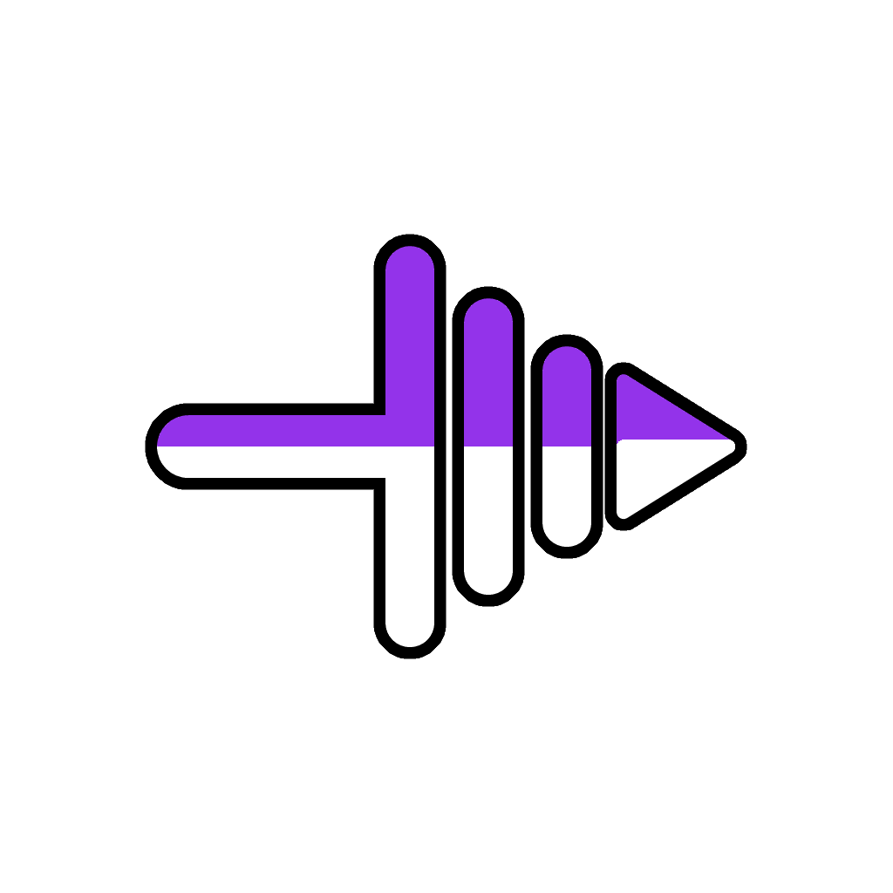

<div align="center">
  

  # Phantek - Video Toolkit Vega

  **Offline video transcoding, downscaling, trimming, and audio extraction for Android.**

  [](https://github.com/zerabyte88/phantek-video-toolkit-vega/releases)
  [](https://github.com/zerabyte88/phantek-video-toolkit-vega/releases)
  [](https://github.com/zerabyte88/phantek-video-toolkit-vega/releases)
  [](https://developer.android.com/media/media3)
  [](LICENSE)

  [Download APK](https://github.com/zerabyte88/phantek-video-toolkit-vega/releases/latest) • [Features](#features) • [Supported Formats](#supported-formats) • [Tech Stack](#tech-stack) • [Build](#build-from-source) • [License](#license)
</div>

---

## Features

- **Dual Transcoding Engine** : Switch between Hardware and Software encoders with automatic bidirectional fallback when the encoders fail or reject unsupported resolutions.
- **Resolution Downscaling** : Scale 4K (2160p) down to 2K (1440p), 1080p, 720p, 480p, or 360p with OpenGL aspect-ratio preservation and even-pixel alignment. Includes hardware resolution capability detection.
- **Video Trimmer** : Keyframe-accurate trimming range slider with interactive video preview, start/end timestamps, and duration calculation.
- **Rate Control** : Constant Quality (CQ/VBR) or custom target bitrate (1-35 Mbps) with framerate clamping (24-60 FPS).
- **Audio Extraction** : Extract audio tracks to M4A/AAC (64-320 kbps or direct copy), MP3 (direct bitstream copy from source), or 16-bit uncompressed PCM WAV.
- **Progress Visualizers** : 8 animation styles (Orbit, Radar, Liquid, Particles, Spiral, Zig-Zag, Capsule, Equalizer) with reduced-motion support.
- **System Integration** : Receive shared video files directly from Android Gallery or File Manager via native Send intent (`SEND` / `SEND_MULTIPLE`).
- **Telemetry & Battery Monitoring** : Live encoding speed, elapsed/estimated remaining time, storage I/O throughput, device battery temperature, and thermal throttling status.
- **Foreground Execution** : Android Foreground Service with CPU `WakeLock`, persistent notification bar with interactive Cancel action, and crash-recovery job markers.
- **AMOLED Themes** : 6 visual themes (*Dark Mode*, *Light Mode*, *Snowfall*, *Clean Light*, *Midnight*, *Sakura*).
- **100% Offline & Private** : Zero network permissions, zero telemetry, and zero external trackers.

---

## Supported Formats

<div align="center">

| Type | Container | Codec / Format | Notes |
| :---: | :---: | :---: | :---: |
| **Video** | `.mp4` | H.264 (`video/avc`), H.265 (`video/hevc`) | Hardware / Software, `+faststart` |
| **Video** | `.mkv` | H.264 (`video/avc`), H.265 (`video/hevc`) | Matroska container |
| **Video** | `.mov` | H.264 (`video/avc`), H.265 (`video/hevc`) | QuickTime container |
| **Audio** | `.m4a` | AAC (`audio/mp4a-latm`) | Hardware accelerated (64-320 kbps or Copy) |
| **Audio** | `.mp3` | MP3 (`audio/mpeg`) | Direct stream copy (matches source bitrate) |
| **Audio** | `.wav` | PCM (`audio/raw`) | 16-bit linear uncompressed PCM |

</div>

---

## Tech Stack

<div align="center">

| Layer | Package / Tool | Role |
| :---: | :---: | :---: |
| **Framework** | Flutter (Dart SDK `^3.13`) | Core UI, state management, and localization |
| **Media Engine** | AndroidX Media3 (`1.11.1`) | `Transformer`, `MediaCodec`, `GlEffect`, and `Muxer` pipeline |
| **Preview** | `video_player` (`^2.14.1`) | Hardware-accelerated video trimmer preview |
| **Background** | `flutter_foreground_task`, `wakelock_plus` | Foreground service execution and CPU wake lock |
| **Hardware & Telemetry** | `device_info_plus`, Native BroadcastReceiver | SoC capability detection, battery temperature, and thermal metrics |
| **Storage & Sharing** | `shared_preferences`, `file_picker`, `share_plus` | Settings persistence, file picker, and intent sharing |

</div>

---

## Build from Source

### Prerequisites

- Flutter SDK `^3.13`
- Android SDK & Java 17+

### Steps

```bash
# Clone repository
git clone https://github.com/zerabyte88/phantek-video-toolkit-vega.git
cd phantek-video-toolkit-vega

# Install dependencies
flutter pub get

# Build release APK
flutter build apk --release
```

Compiled binary : `build/app/outputs/flutter-apk/app-release.apk`

---

## License

This project is open-source software licensed under the **[MIT License](LICENSE)**.

Third-party components (AndroidX Media3, Kotlin Coroutines, Flutter, and bundled packages) are subject to their respective licenses (Apache 2.0, BSD, MIT) and can be inspected in-app under **Settings > About > License**.
